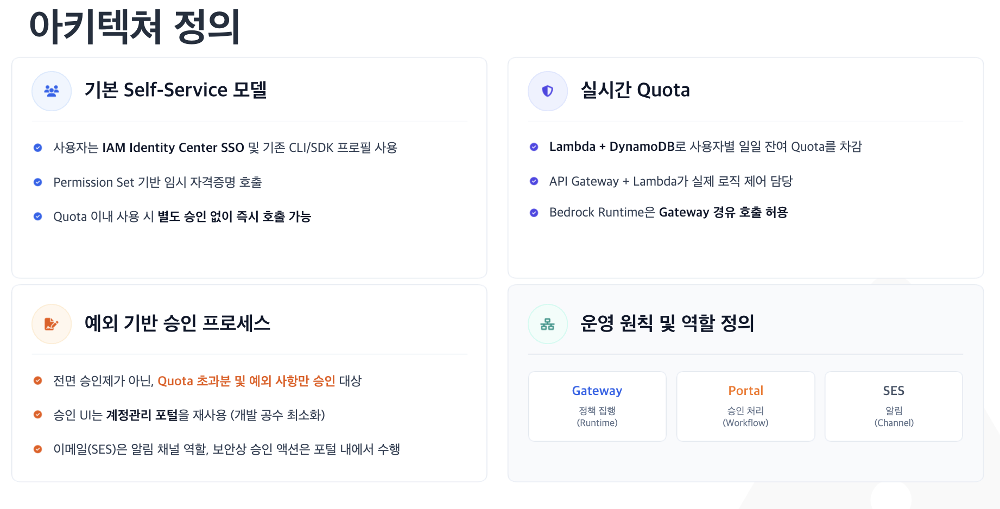
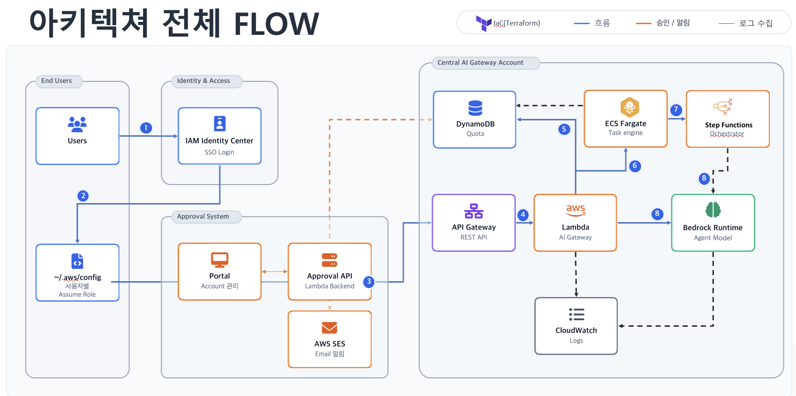
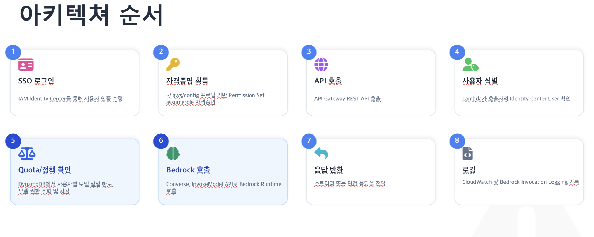

# Bedrock AI LLM Pipeline

AWS Bedrock 모델 사용을 중앙 정책으로 통제하는 `Bedrock Gateway`와 운영 포털을 함께 구성한 저장소입니다.
사용자별 월간 KRW 한도, 승인 워크플로, 실시간 사용량 추적, 장시간 추론 분리 처리, 배치 추론, 운영 감사 로그를 하나의 흐름으로 관리합니다.

## Architecture Overview

### 아키텍쳐 정의

게이트웨이는 전면 승인제가 아닌 **Self-Service + 예외 승인** 모델입니다.
사용자는 IAM Identity Center SSO와 기존 CLI/SDK 프로필을 그대로 사용하고, Quota 이내에서는 별도 승인 없이 즉시 모델을 호출합니다.
Quota 초과분과 예외 사항만 승인 대상이며, 승인 UI는 기존 계정관리 포털을 재사용합니다.
역할은 `Gateway`(정책 집행 / Runtime), `Portal`(승인 처리 / Workflow), `SES`(알림 채널)로 분리됩니다.

### 아키텍쳐 전체 Flow

End Users / Identity & Access / Approval System / Central AI Gateway Account 네 영역으로 구성되며, 전체 리소스는 Terraform(IaC)으로 관리됩니다.

### 아키텍쳐 순서

| 단계 | 동작 | 설명 |
|---|---|---|
| 1 | SSO 로그인 | IAM Identity Center를 통해 사용자 인증 수행 |
| 2 | 자격증명 획득 | `~/.aws/config` 프로필 기반 Permission Set assume role 자격증명 |
| 3 | API 호출 | API Gateway REST API 호출 |
| 4 | 사용자 식별 | Lambda가 호출자의 Identity Center User 확인 |
| 5 | Quota/정책 확인 | DynamoDB에서 사용자별 모델 일일 한도, 모델 권한 조회 및 차감 |
| 6 | Bedrock 호출 | Converse, InvokeModel API로 Bedrock Runtime 호출 |
| 7 | 응답 반환 | 스트리밍 또는 단건 응답을 전달 |
| 8 | 로깅 | CloudWatch 및 Bedrock Invocation Logging 기록 |

### 구현 기준 흐름

현재 구현/배포 구조 기준으로 다음 흐름을 따릅니다.

1. 사용자는 `IAM Identity Center` 기반으로 인증합니다.
2. 모델 호출은 `API Gateway`와 `Lambda Gateway`를 통해서만 진입합니다. 직접 Bedrock 호출은 IAM 정책으로 차단됩니다.
3. `DynamoDB`에서 사용자 정책, 가격, 한도, 요청 ledger를 조회/기록합니다.
4. 짧은 요청은 Lambda에서 직접 Bedrock을 호출합니다.
5. 장시간 요청은 `Step Functions + ECS Fargate`로 우회해 처리합니다.
6. 대량 오프라인 작업은 Bedrock 배치 추론으로 처리합니다.
7. 승인, 알림, 감사 추적까지 운영 포털과 함께 연결됩니다.

## Gateway Routes

게이트웨이는 단일 Lambda(`infra/bedrock-gateway/lambda/handler.py`)에서 경로별로 분기합니다.
모든 경로는 호출 전 정책 조회 → 모델 접근 제어 → 가격 조회 → 한도 검사 순서를 공유합니다.

### 동기 추론

| 경로 | 설명 |
|---|---|
| `POST /converse` (루트 `POST /` 도 동일 처리) | Bedrock Converse API 기반 기본 추론 경로 |
| `POST /invoke` | InvokeModel 패스스루 (이미지 생성, 편집, 임베딩, rerank) |
| `POST /openai/responses` | OpenAI Responses 호환 경로 |

동기 경로는 **자동으로 비동기로 전환**될 수 있습니다. API Gateway의 29초 하드 타임아웃을 넘길 위험이 있는 호출은
게이트웨이가 스스로 비동기 작업으로 넘기고 `202` + `job_id`를 반환합니다. 전환 기준은 세 가지입니다.

- 모델이 상시 비동기 대상으로 분류된 경우 (DynamoDB 라우팅 플래그 또는 in-code 폴백 목록)
- 동기 Bedrock 호출이 20초(`SYNC_TIMEOUT_SECONDS`, 29초 대비 9초 버퍼) 안에 끝나지 않거나 throttle이 발생한 경우
- `/invoke` 대상 모델이 29초를 상시 초과하는 이미지 업스케일 계열인 경우

### 비동기 추론 (장시간 작업)

예약(reserve) → 실행 → 정산(settle) 패턴으로 분리 실행합니다.
제출 시 상한 비용을 `__reserved__{job_id}` 행으로 선점해 한도 초과를 사전에 차단하고, 완료 시 실제 비용으로 정산합니다.
실행은 `Step Functions + ECS Fargate` 워커가 담당하며, 동시 실행은 세마포어 테이블로 제한됩니다.

| 경로 | 설명 |
|---|---|
| `POST /converse-jobs`, `GET /converse-jobs/{job_id}` | 비동기 Converse 작업 제출/조회 |
| `POST /openai/responses-jobs`, `GET /openai/responses-jobs/{job_id}` | 비동기 Responses 작업 제출/조회 |
| `POST /invoke-jobs`, `GET /invoke-jobs/{job_id}` | 비동기 InvokeModel 작업. 동기 한도를 초과하는 이미지 편집·업스케일 작업용 |
| `POST /{converse-jobs,openai/responses-jobs,invoke-jobs}/{job_id}/cancel` | 실행 중 작업 취소. 세 계열 모두 지원 |

### 배치 추론

| 경로 | 설명 |
|---|---|
| `POST /batch` | S3 JSONL 입력 기반 Bedrock 배치 추론 작업 제출 |
| `GET /batch/{job_id}` | 배치 작업 상태 및 S3 출력 참조 조회 |

배치 추론은 온디맨드 대비 **50% 할인** 단가가 적용됩니다.
입력 토큰 수를 업로드된 JSONL에서 정확히 계산할 수 있어, 실시간 경로보다 오히려 강한 한도 보장이 성립합니다.
예약은 한도 검사 **이전에** 기록되므로 하드 블록이 예약분을 포함해 판정됩니다.

운영 제한값 (기본값, `__gateway_config__`로 상향/하향 가능):

| 항목 | 기본값 |
|---|---|
| 레코드 수 | 최소 100 / 최대 50,000 |
| 동시 실행 작업 | principal당 10 / 전체 50 |
| 예약 TTL | 48시간 (최대 작업 타임아웃 24시간보다 길게) |

### 직접 호출 사전 승인 (Control Plane)

| 경로 | 설명 |
|---|---|
| `POST /longrun/authorize` | 장시간 호출을 **사전 승인**하고 예약분을 기록. 게이트웨이는 Bedrock을 호출하지 않음 |
| `POST /longrun/settle` | 클라이언트가 직접 호출한 결과의 실사용량을 사후 정산 |

이 경로는 게이트웨이가 프록시가 아니라 **컨트롤 플레인으로만** 동작합니다.
`/longrun/authorize`가 정책·모델 접근·가격·한도를 검증하고 비관적 추정으로 예산을 선점한 뒤 `tracking_id`를 발급하면,
클라이언트가 `ConverseStream`을 **직접** 호출하고 완료 후 `/longrun/settle`로 실사용량을 정산합니다.
스트리밍처럼 게이트웨이를 경유시키기 어려운 호출을 한도 통제 안에 두기 위한 경로입니다.

### 정책 / 운영

| 경로 | 설명 |
|---|---|
| `GET /quota/status` | 현재 사용량, 유효 한도, 승인 대기 상태 조회 (읽기 전용) |
| `POST /approval/request` | 한도 증액 승인 요청 생성 |

## Key Components

- `infra/bedrock-gateway/lambda/`
  - `handler.py` — 게이트웨이 본체. 라우팅, 정책 집행, 한도 검사, 정산, 감사 ledger
  - `model_sync_handler.py` — 신규 Bedrock 모델 자동 동기화. EventBridge `cron(0 0 * * ? *)` 일 1회
  - `routing_cache.py` — 비동기 라우팅 플래그 캐시 (DynamoDB 기반, 코드 재배포 불필요)
- `infra/bedrock-gateway/stream/`
  - 장시간 출력 스트리밍 처리. Lambda Function URL 기반
- `infra/bedrock-gateway/worker/`
  - ECS Fargate 워커. 비동기 작업 실행 및 정산
- `infra/bedrock-gateway/dispatcher/`
  - 대기 작업 디스패치 및 슬롯 관리
- `account-portal/`
  - 운영자가 사용자/팀/승인/사용량을 관리하는 포털
- `docs/bedrock-gateway-README.md`
  - Bedrock Gateway 아키텍처와 실제 배포 구성을 정리한 상세 문서

## Cost & Quota Control

- **월간 KRW 한도** — 사용자별 기본 한도에 임시 증액(boost)을 합산해 유효 한도를 계산합니다. KST 기준 월 단위로 리셋됩니다.
- **하드 캡** — 유효 한도는 `max_monthly_cost_limit_krw`에서 상한 처리되어, 증액이 누적되어도 이 값을 넘지 않습니다.
- **예약 기반 선차단** — 비동기·배치 작업은 상한 비용을 먼저 예약한 뒤 한도를 검사하므로, 실행 후 초과가 발생하지 않습니다.
- **단계별 증액 승인** — 증액분은 서버가 현재 한도에 따라 재계산합니다(200만원 미만 50만원, 이상 100만원). 요청자가 임의 금액을 지정할 수 없습니다.
- **경고 알림** — 사용량 90% 및 한도 소진 시점에 SES로 알림하며, 월 인식 중복 제거로 같은 달 같은 밴드에서 재발송하지 않습니다.
- **멱등성** — 모든 추론 경로가 `request_id` 기준 멱등성 레코드를 선점합니다(TTL 24시간). 중복 요청은 재과금 없이 기존 결과 또는 `409`를 돌려줍니다.

### 상태 저장 구조

DynamoDB 15개 테이블로 정책·사용량·작업 상태를 분리 관리합니다.

| 분류 | 테이블 |
|---|---|
| 정책 / 조직 | `principal_policy`, `team_config`, `model_pricing` |
| 사용량 / 과금 | `monthly_usage`, `daily_usage`, `request_ledger` |
| 한도 증액 | `temporary_quota_boost`, `approval_request`, `approval_pending_lock` |
| 작업 상태 | `job_state`, `longrun_request`, `concurrency_semaphore` |
| 감사 / 기타 | `governance_audit`, `session_metadata`, `idempotency_record` |

## Model Access Control

- 모델 접근은 사용자별 allowlist로 제한됩니다.
- 온디맨드 호출을 지원하지 않는 모델(일부 Stability 이미지 편집 모델, Cohere Embed 4)은 게이트웨이가 시스템 정의 추론 프로파일(`us.` 접두)로 자동 재작성합니다. 호출자는 표준 모델 ID를 그대로 사용합니다.
- 신규 모델은 일일 자동 동기화 파이프라인이 카탈로그와 가격을 갱신하므로, 온보딩에 코드 배포가 필요하지 않습니다.

## Access Paths

- **IAM Identity Center (SSO)** — 기본 접근 경로
- **IAM Roles Anywhere** — 온프렘 DGX 환경에서 인증서 기반으로 게이트웨이에 접근합니다 (`rolesanywhere.tf`)
- **ParallelCluster** — 클러스터 역할이 사용자 역할을 assume 해 접근합니다

## Detailed Docs

- [Bedrock Gateway Architecture](./docs/bedrock-gateway-README.md)
- [Long-running Bedrock Architecture](./docs/ai/long-running-bedrock-architecture-final.md)
- [Gateway Control Plane / Longrun Data Plane](./docs/ai/gateway-control-plane-longrun-data-plane-final.md)
- [Gateway Final Validation Report](./docs/ai/gateway-final-validation-report.md)
- [Gateway v2 Spec](./docs/ai/gateway-v2-spec.md)

## Operational Focus

- 사용자별 KRW 월간 한도 관리
- 승인 기반 예외 처리
- `request_ledger`, `monthly_usage` 중심의 사용량 추적
- 장시간 추론 분리 실행 및 배치 추론 비용 절감
- 운영 포털 기반 가시성 확보

## Configuration

`infra/bedrock-gateway/env/dev.tfvars`의 환경별 실제 값은 이 저장소에 포함하지 않습니다.
계정 고유 값은 `<SES_SENDER_EMAIL>`, `<ADMIN_EMAIL>`, `<PRIVATE_SUBNET>`, `<SECURITY_GROUP>`,
`<DGX_CLIENT_CA_CERTIFICATE_PEM>` 형태의 placeholder로 치환되어 있으므로, 배포 시 실제 값으로 채워야 합니다.
